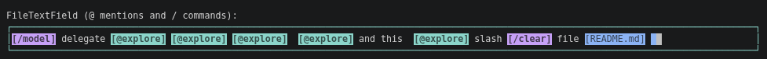

A Nocterm `TextField` wrapper that displays attached files and colored tokens
inline in the input line.



## Features

- **Inline file attachments** – paste a path or attach programmatically;
  `[lib/main.dart]` and `[image 1]` labels are colored in place; Backspace
  removes a token and detaches the file as one unit.
- **Colored tokens** – `InlineToken` entries paint `@mentions`, `/commands`, or
  any substring; styles support colors, `bold`, `italic`, `underline`, and
  square, custom, or no brackets around the label.
- **Host-owned suggestion menus** – the application supplies `@` and `/`
  candidates (`FileTextFieldSuggestion.file`, `.folder`, `.agent`, `.command`);
  the field filters, selects, and inserts them.
- **Optional `/` anchor** – `slashAnchor: SlashAnchor.startOnly` restricts the
  slash menu to the very start of the field; the default opens it at any word
  boundary.
- **Token components** – `TokenHighlightTextField` for editable input and
  `TokenText` for read-only previews.

## Getting Started

```yaml
dependencies:
  nocterm: ^0.9.0
  nocterm_file_color: ^0.0.2
```

## Usage

File and token suggestions belong to the host application. Supply them through
`onSuggestionsRequested`; the field handles filtering, keyboard and mouse
selection, and colored inline rendering.

```dart
import 'package:nocterm/nocterm.dart';
import 'package:nocterm_file_color/nocterm_file_color.dart';

final input = FileTextField(
  onSuggestionsRequested: (trigger, query) {
    if (trigger == '/') {
      return [
        FileTextFieldSuggestion.command(
          name: 'help',
          style: const FileStyle(bold: true),
        ),
      ];
    }
    return [FileTextFieldSuggestion.agent(name: 'explore')];
  },
  onSuggestionSelected: (suggestion) {
    // The host decides what a command or agent should do.
  },
  onFilesChanged: (files) {
    // Attached files, ready to send to your model.
  },
);
```

## Coloring tokens

Beyond files, arbitrary strings are colored by `InlineToken` entries. Each
entry colors one occurrence of its token string (the leftmost match not yet
colored), so register one entry per inserted label.

```dart
const tokens = [
  InlineToken(
    token: '@explore',
    style: FileStyle(text: Colors.brightCyan, openingDelimiter: ''),
  ),
  InlineToken(
    token: '/help',
    style: FileStyle(text: Colors.brightMagenta, openingDelimiter: ''),
  ),
];

// Editable input with colored tokens.
TokenHighlightTextField(controller: controller, tokens: tokens);

// Read-only preview for transcripts and lists.
TokenText(text: 'Run @explore or /help', tokens: tokens);
```

Token styles accept foreground and background colors, `bold`, `italic`, and
`underline`. Delimiters wrap the token label; the default is `[` and `]`, any
other string works, and empty strings render the bare token text:

```dart
FileStyle()                                              // → [lib/main.dart]
FileStyle(openingDelimiter: '<', closingDelimiter: '>')  // → <lib/main.dart>
FileStyle(openingDelimiter: '', closingDelimiter: '')    // →  lib/main.dart
```

## Suggestions

- `FileTextFieldSuggestion.file` inserts a colored token and registers an
  attachment, retrievable via `getAttachedFiles()`; `.folder`, `.agent`, and
  `.command` insert app-specific tokens only.
- Clicking a colored file token reports `onFileClick`, or opens the file
  location in the platform file manager by default.
- The provider receives `@` or `/` plus the query; the field filters the
  returned candidates case-insensitively by `name` and `searchText`.
- `FileStyle` colors the inserted token; menu labels render neutrally unless
  a `suggestionMenuBuilder` provides a custom menu component.
- `onSuggestionSelected` reports the selection to the host; the package never
  executes agents or commands.

## Default file colors

| Type | Color |
|------|-------|
| Image | Magenta |
| Document | Blue |
| Code | Green |
| Archive | Yellow |
| Audio / Video | Cyan |
| Other | Grey |

Tune defaults per type and overrides per extension with `FileConfig`.

## Example

See `example/nocterm_file_color_example.dart` for a complete runnable demo.

## License

MIT
