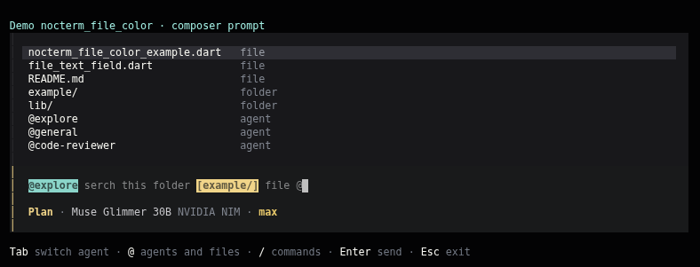

# Nocterm File Color

[](https://github.com/AmidVoshakul/nocterm_file_color/actions/workflows/ci.yml)
[](https://github.com/AmidVoshakul/nocterm_file_color/actions/workflows/release.yml)
[](LICENSE)
[](https://github.com/AmidVoshakul/nocterm_file_color/actions)
[](https://pub.dev/packages/nocterm_file_color)
[](https://pub.dev/packages/nocterm_file_color/score)
[](https://pub.dev/packages/nocterm_file_color/score)
[](https://dart.dev)

A Nocterm `TextField` wrapper that displays attached files and colored tokens
inline in the input line.

<p align="center">
  
</p>

Swap the standard Nocterm `TextField` for `FileTextField` and your plain-text
`TextEditingController` value stays untouched — but files, folders, agents,
commands and skills become colored tags you can click (`[lib/main.dart]`,
`[image 1]`, `[lib/]`, `@agent`, `/command`). A large paste collapses into a
single `[Pasted ~N lines]` tag that expands again when you send, and the `@` and
`/` menus are either drawn by the package or handed to your own layout. Read
everything attached through `getAttachedFiles()` when you send the message.

<p align="center">
  
</p>

## 🚀 Getting Started

Add the dependency:

```yaml
dependencies:
  nocterm: ^0.9.0
  nocterm_file_color: ^0.1.0
```

## Usage

Your application owns the suggestions — files, agents, commands, whatever your
app can offer. Pass them through `onSuggestionsRequested`, and the field takes
care of the rest: filtering, keyboard and mouse selection, and colored inline
rendering.

```dart
import 'package:nocterm/nocterm.dart';
import 'package:nocterm_file_color/nocterm_file_color.dart';

final input = FileTextField(
  onSuggestionsRequested: (trigger, query) {
    if (trigger == '/') {
      return [const FileTextFieldSuggestion.command(name: 'help')];
    }
    return const [FileTextFieldSuggestion.agent(name: 'explore')];
  },
  onSuggestionSelected: (suggestion) {
    // Your app decides what a command or agent should do.
  },
  onFilesChanged: (files) {
    // Attached files, ready to send to your model.
  },
);
```

Agents, folders, and commands need no `style`: each kind falls back to a
default token color, and you override it with `FileStyle` where you want:

```dart
FileTextFieldSuggestion.agent(name: 'explore')                     // default cyan
FileTextFieldSuggestion.agent(
  name: 'explore',
  style: FileStyle(text: Colors.brightCyan, openingDelimiter: ''),
)
```

Give files their colors from a `FileConfig`, exactly like attachments:

```dart
final config = FileConfig.defaultConfig();
FileTextFieldSuggestion.file(file, style: config.styleFor(file));
```

## Growing input

Let the composer grow with its input: set `maxLinesVisible` to the row cap you
want (8 by default). Up to that height the field adds a row per line of text;
beyond it the text scrolls and the caret is kept in view, so a composer never
grows without bound and breaks your layout. Pass `maxLines: null` to lift the
one-line cap entirely.

```dart
FileTextField(
  controller: controller,
  maxLines: null,
  maxLinesVisible: 8,
);
```

## Prompt history

You get prompt history for free: the field keeps submitted prompts and recalls
them with ArrowUp/ArrowDown (readline edge-stepping — the caret snaps to the
line edge first, then history; draft save/restore; consecutive dedup; capacity
cap). In-memory by default; inject a `PromptHistoryStorage` when you want
persistence — a ready `FilePromptHistoryStorage` plus `PromptHistoryCodec`
JSONL is included.

```dart
FileTextField(
  controller: controller,
  promptHistory: PromptHistoryController(),
);
```

## Prompt conventions

If your project carries skills, commands or agents in the conventional
directories, `PromptIndex` finds them for you — one `load()` covers all three
families, and the menus work out of the box for the open `.agents/` standard:

| Family | Default root | File → token |
| --- | --- | --- |
| Skills | `.agents/skills` | `<name>/SKILL.md` → `/name` |
| Commands | `.agents/commands` | `<name>.md` → `/name`, `sub/name.md` → `/sub:name` |
| Agents | `.agents/agents` | `<name>.md` → `@name` |

The package stays vendor-neutral: `.claude/`, `.opencode/`, your own
`.chatorai/` and any global, plugin or home-based roots are *your* policy —
pass them in and they are scanned too:

```dart
final index = PromptIndex(); // a field of your State class

@override
void initState() {
  super.initState();
  _load();
}

Future<void> _load() async {
  // Home and XDG paths resolve in your app (platforms differ); the package
  // never guesses them. Roots scan in the order you list them, and the first
  // source that defines a name wins — a project asset beats an added global
  // one of the same name.
  await index.load(
    extraCommandRoots: ['.claude/commands', '.opencode/commands'],
    extraAgentRoots: [myGlobalAgentsDir], // e.g. resolved by your own XDG helper
  );
  if (mounted) setState(() {});
}

// In build:
FileTextField(
  controller: controller,
  // `/` lists commands and skills, `@` lists agents — merge your own
  // file/folder suggestions into the result.
  onSuggestionsRequested: (trigger, query) => index.suggestionsFor(trigger),
  // The user typed `/plan`; the model receives the full SKILL.md body, and a
  // command body gets its `$ARGUMENTS` substituted.
  onSubmitted: (text) => send(index.expandTokens(text)),
);
```

Discovery is asynchronous, so tell the field when it lands — an open menu
would otherwise keep its stale rows until the next keystroke:

```dart
fieldKey.currentState?.refreshSuggestions();
```

A note on precedence: roots are scanned in the order you give them, and the
first source that defines a name wins — a project `.agents/commands` beats an
added `.claude/commands` of the same name, and the entry discovered later is
dropped. Claude Code itself prefers personal (`~/.claude`) over project; if you
want to mirror that, compose the per-family indexes directly and order their
roots yourself.

Ecosystems whose files are not Markdown-with-frontmatter — Gemini's TOML
commands (`.gemini/commands/*.toml`), Cursor's `.mdc` rules — are outside the
package's scope on purpose: its indexes match `.md` files only. Support them in
your own layer (read the files, build the suggestions) — no vendor magic is
baked in, and nothing pretends to parse formats it cannot see. The `parser:`
injection point covers the richness of Markdown frontmatter (full YAML for
hosts that need it), not other file formats.

Every asset reaches you as an immutable model — `SkillInfo`, `CommandInfo`,
`AgentInfo` — with `description` (menu rows and query filtering), `body` (the
markdown to run) and `path`; `toSuggestion()` maps each onto its menu kind with
the package's default plate. The built-in parser reads `name`, `description`
(folded/literal blocks, quoted scalars, plain multi-line) and
`disable-model-invocation` (YAML 1.1 truthy family), appending `when_to_use` to
the summary — with zero dependencies. Need full YAML? Pass your own parser to
`SkillIndex(parser: ...)` / `CommandIndex(parser: ...)` /
`AgentIndex(parser: ...)`.

### Two ways to show a sent command

When the user submits `/plan fix the auth bug`, clients differ in what the
*transcript* shows — and both are one call apart:

| | Transcript shows | The model receives |
| --- | --- | --- |
| opencode-style | the command's expanded prompt | the same expanded prompt |
| copilot-style | the colored `/plan` tag, exactly like the input | the same expanded prompt |

```dart
onSubmitted: (text) {
  final payload = index.expandTokens(text); // what the model gets
  final showTags = /* your setting */ false;
  messages.add(
    showTags
        ? transcriptEntry(text, tokens: index.inlineTokensFor(text))
        : transcriptEntry(payload),
  );
  send(payload);
}
```

Under the default auto mode the text typed after a command or skill token is
handled the way the major CLIs handle it:

- the body asks for `$ARGUMENTS` → the tail fills the placeholder and is
  consumed, so `/plan fix the auth bug` with a `Focus: $ARGUMENTS` body
  expands to `Focus: fix the auth bug`, the text appearing once;
- the body has no placeholder → the tail is appended to the body after a blank
  line (the Gemini-CLI convention), so nothing the user typed is lost.

Override with `expandTokens(text, arguments: '...')`, or ask for verbatim
token replacement with `autoArguments: false`. `inlineTokensFor(text)` hands
you the matching tokens as `InlineToken`s styled with your command and skill
plates (`commandStyle:` / `skillStyle:`), so a `TokenText` transcript renders
the tags identically to the composer.

Prefer one family without the facade? Call `SkillIndex().skillsIn(root)`,
`CommandIndex().commandsIn(root)` or `AgentIndex().agentsIn(root)` directly —
each scans its own roots (plus `extraRoots`), dedupes by name with the first
source winning, and never throws. Running a command or an agent — permissions,
arguments, side effects — stays in your application; the package only reads the
files.

## Attachment chips

Show the files attached to a sent message as chips at the end of the message
text: a colored `File`/`dir` label plate followed by a gray name plate. Colors
come from your `FileConfig` and the Nocterm theme, and honor `NO_COLOR`.

```dart
FileChips(
  items: [
    for (final file in files) FileChipItem.file(file),
    FileChipItem.directory('lib/'),
  ],
);
```

Tune the row to your chat UI with `labelBuilder`,
`nameTextColor`/`nameBackgroundColor`, `config`, `gap`, `wrap` and
`onChipTap`.

## Pasting

Long pastes collapse on their own: 3+ lines or 150+ characters become a single
`[Pasted ~N lines]` tag that expands again when the message is submitted and
deletes as one unit. Retune or switch the behavior off with
`enablePasteCollapse`, `pasteCollapseMinLines`, `pasteCollapseMinChars` and
`pasteStyle`, and read the originals back with `getPastedTexts()` or
`getExpandedText()`.

## Coloring tokens

You can color arbitrary strings, too — register one `InlineToken` per inserted
label and each entry colors one occurrence of its token string (the leftmost
match not yet colored):

```dart
const tokens = [
  InlineToken(
    token: '@explore',
    style: FileStyle(text: Colors.brightCyan, openingDelimiter: ''),
  ),
  InlineToken(
    token: '/help',
    style: FileStyle(text: Colors.brightMagenta, openingDelimiter: ''),
  ),
];

// Editable input with colored tokens.
TokenHighlightTextField(controller: controller, tokens: tokens);

// Read-only preview for transcripts and lists.
TokenText(text: 'Run @explore or /help', tokens: tokens);
```

Token styles accept foreground and background colors, `bold`, `italic`, and
`underline`. Delimiters wrap the token label; the default is `[` and `]`, any
other string works, and empty strings render the bare token text:

```dart
FileStyle()                                              // → [lib/main.dart]
FileStyle(openingDelimiter: '<', closingDelimiter: '>')  // → <lib/main.dart>
FileStyle(openingDelimiter: '', closingDelimiter: '')    // →  lib/main.dart
```

### Rendering the menu yourself

By default the field paints a neutral menu directly above the input. Replace it
in place with `suggestionMenuBuilder`, or drop it entirely with
`SuggestionMenuPlacement.host` and draw it wherever your layout needs — for
instance as a separate panel above your own prompt container.

<p align="center">
  
</p>

```dart
class MyComposer extends StatefulComponent {
  const MyComposer({super.key});

  @override
  State<MyComposer> createState() => _MyComposerState();
}

class _MyComposerState extends State<MyComposer> {
  final fieldKey = GlobalKey<FileTextFieldState>();
  final controller = TextEditingController();

  @override
  Component build(BuildContext context) {
    final menu = fieldKey.currentState?.visibleSuggestions ?? const [];
    final selected = fieldKey.currentState?.selectedSuggestionIndex ?? -1;

    return Column(
      children: [
        // Only rendered while the menu is open.
        if (menu.isNotEmpty)
          MyMenu(
            rows: menu,
            highlighted: selected,
            onPick: (row) => fieldKey.currentState!.selectSuggestion(row),
          ),
        FileTextField(
          key: fieldKey,
          controller: controller,
          focused: true,
          onSuggestionsRequested: (trigger, query) => myCandidates(trigger),
          // The field stops painting its own menu; trigger detection,
          // filtering and keyboard navigation stay inside it either way.
          suggestionMenuPlacement: SuggestionMenuPlacement.host,
          // Rebuilds this widget so the panel tracks the menu.
          onSuggestionMenuChanged: () => setState(() {}),
        ),
      ],
    );
  }
}
```

What the state gives you while the menu is open:

- `visibleSuggestions` — read the candidates for the open menu; empty when closed.
- `selectedSuggestionIndex` — the highlighted row, `-1` when closed.
- `selectSuggestion(candidate)` — pick a row programmatically, e.g. on click.
- `highlightSuggestion(index)` — move the one highlight, e.g. on mouse hover, so the keyboard selection and the pointer never highlight two rows.
- `onSuggestionMenuChanged` — rebuild when the menu opens/closes, its query
  changes, or the highlight moves. Arrow keys move the highlight without
  editing text, so `onChanged` alone is not enough.
- `navigationDepth`, `canNavigateBack`, `currentBasePath` — the directory the
  menu is browsing. A suggestion with a `path` becomes a tree node:
  `RightArrow` drops into the highlighted folder, `LeftArrow` leaves it, and
  the caret stays put while the menu is open.
- `FileTextFieldSuggestion.session` — insert an `@session <name>` token, with
  `prefix` to render `@<name>` or a bare `<name>` instead.
- `SuggestionMenuGrouping` — reorder, rename or merge the sections (several
  kinds may share one heading), and `visibleSuggestionGroups` hands the same
  structure to a host-rendered menu. Headings appear only when more than one
  section is present.

Trigger detection, filtering, keyboard navigation and token insertion stay
inside the package either way. See `example/` for a full implementation.

## 🎨 Default file colors

| Type | Color |
|------|-------|
| **Image** | Magenta |
| **Document** | Blue |
| **Code** | Green |
| **Archive** | Yellow |
| **Audio** / **Video** | Cyan |
| **Other** | Grey |

Tune the defaults per type, or override per extension, with `FileConfig`.

## Example

Run and read [`example/nocterm_file_color_example.dart`](example/nocterm_file_color_example.dart) for a complete composer demo.

## 🤝 Contributing

See [CONTRIBUTING.md](CONTRIBUTING.md) for development setup, checks, and
pull request guidelines.

## ⚖️ License

Distributed under the MIT License. See [`LICENSE`](LICENSE) for details.

---

<div align="right">

Created by [Amid Voshakul 🌠](https://github.com/AmidVoshakul)

</div>
